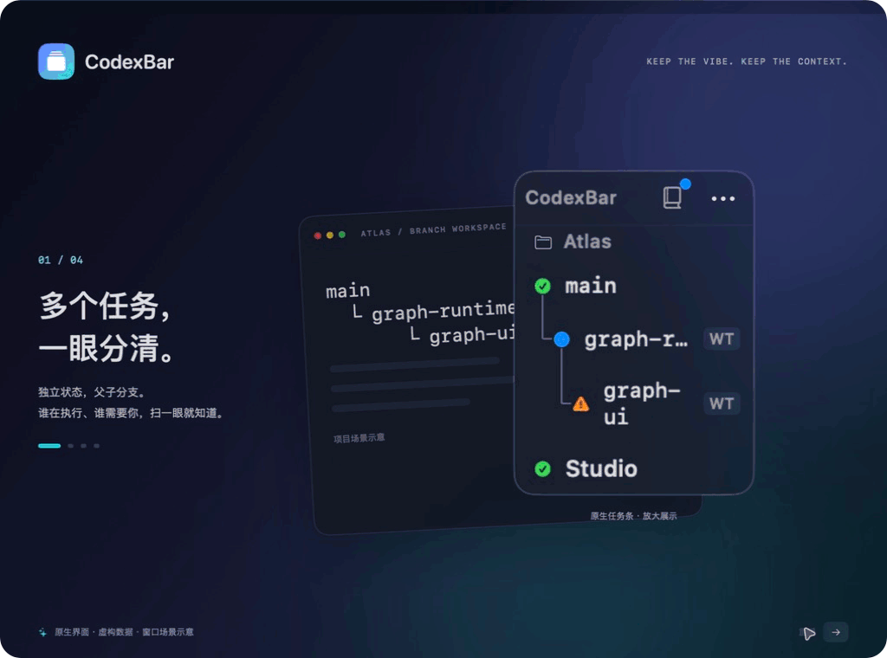

  

<h3 align="center">Hi, I'm zmylol 👋</h3>

<i>Collecting useful little spells along the way.</i>

I build local-first AI tools. My main focus is <b><a href="https://github.com/zmylol/MiniClaude">MiniClaude</a></b>.

## ✨ Featured project

  

**A local-first AI agent for your terminal and desktop.** MiniClaude brings tool execution, permission approvals, and saved conversations into one agent runtime.

- **Choose your workspace.** Use the CLI, terminal UI, or native macOS desktop.
- **Follow the work.** Watch streaming replies and tool execution, approve actions, stop runs, and resume saved conversations.
- **Connect your tools.** Work with built-in file and shell tools, parallel tool calls, and MCP integrations.

**[Get started with MiniClaude →](https://github.com/zmylol/MiniClaude#快速开始)**

[Desktop guide](https://github.com/zmylol/MiniClaude/blob/main/docs/DESKTOP.md) · [Roadmap](https://github.com/zmylol/MiniClaude/blob/main/ROADMAP.md) · [Feedback & ideas](https://github.com/zmylol/MiniClaude/issues)

---

### Also building

**[CodexBar](https://github.com/zmylol/CodexBar)** — A native macOS companion for following Codex tasks across VS Code projects, with an Obsidian knowledge reader.

CodexBar demos &amp; setup

 

<table align="center">
  <tr>
    <td width="50%" align="center">
      <b>🪟 CodexBar · Task progress</b> 
      Follow progress, read replies, step in when needed.
    </td>
    <td width="50%" align="center">
      <b>📚 Obsidian × Codex automations</b> 
      Browse articles and summaries by vault, and track what you've read.
    </td>
  </tr>
  <tr>
    <td width="50%" align="center" valign="top">
      
    </td>
    <td width="50%" align="center" valign="top">
      
    </td>
  </tr>
  <tr>
    <td align="center">
      <a href="https://github.com/zmylol/CodexBar#看看它怎么工作">Feature demo</a> · <a href="https://github.com/zmylol/CodexBar/blob/main/docs/images/task-demo-poster.png">Static preview</a>
    </td>
    <td align="center">
      <a href="assets/knowledge-demo-rounded.svg">View full size</a> · <a href="https://github.com/zmylol/CodexBar/blob/main/docs/KNOWLEDGE_SETUP.md">Setup guide</a>
    </td>
  </tr>
</table>

<b>Codex automations</b> read source articles on a schedule, summarize them, and save the results to <b>Obsidian vaults</b>. <b>CodexBar</b> displays articles, summaries, and unread status; click to keep reading in Obsidian.

Native UI recordings in Chinese · Fictional tasks and articles; project windows illustrate the workflow · Click either animation to enlarge

<a href="https://github.com/zmylol/CodexBar#快速开始">Get started with CodexBar</a> · <a href="https://github.com/zmylol/CodexBar/issues">Feedback &amp; ideas</a>

### 🪄 My spellbook

  

Python · Textual · SwiftUI · AppKit · MCP

 

Theme inspired by <a href="https://websunday.net/work/708/">Frieren: Beyond Journey's End</a> · <a href="assets/frieren-artwork.md">Artwork notes</a>

