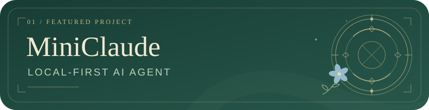
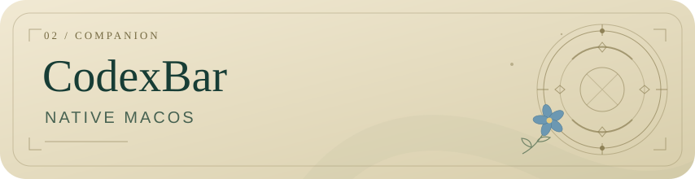
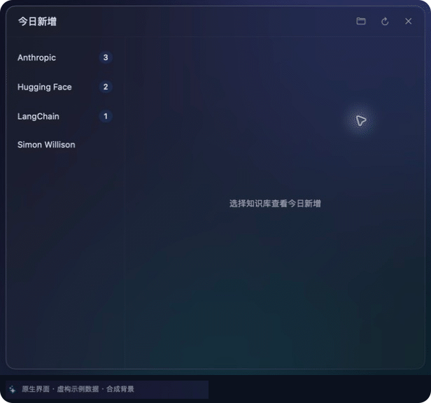

  

<h3 align="center">Hi, I'm zmylol 👋</h3>

<i>Collecting useful little spells along the way.</i>

  

I build local-first AI tools that bring <b>agent workflows</b> to <b>native desktop experiences</b>.

  
  

<h3 align="center">🪄 My spellbook</h3>

  

Python · Textual · SwiftUI · AppKit · MCP

## 📖 Things I'm building

  
  

- **🧠 [MiniClaude](https://github.com/zmylol/MiniClaude)** — A local AI agent system connecting CLI, terminal, and desktop clients, with tool calling, permission approvals, session management, and MCP support.  
  [Get started →](https://github.com/zmylol/MiniClaude#快速开始) · [Roadmap](https://github.com/zmylol/MiniClaude/blob/main/ROADMAP.md)
- **🪟 [CodexBar](https://github.com/zmylol/CodexBar)** — A native macOS floating bar for tracking Codex progress across VS Code projects. Hover to read replies, click to return to a project, or browse your knowledge base.  
  [Get started →](https://github.com/zmylol/CodexBar#快速开始) · [Explore features](https://github.com/zmylol/CodexBar#看看它怎么工作)

## 🎞️ A glimpse of the journey

<table align="center">
  <tr>
    <td width="50%" align="center">
      <b>🪟 CodexBar · Task progress</b> 
      Follow progress, read replies, step in when needed.
    </td>
    <td width="50%" align="center">
      <b>📚 Obsidian × Codex automations</b> 
      Browse articles and summaries by vault, and track what you've read.
    </td>
  </tr>
  <tr>
    <td width="50%" align="center" valign="top">
      
    </td>
    <td width="50%" align="center" valign="top">
      
    </td>
  </tr>
  <tr>
    <td align="center">
      <a href="https://github.com/zmylol/CodexBar#看看它怎么工作">Feature demo</a> · <a href="https://github.com/zmylol/CodexBar/blob/main/docs/images/task-demo-poster.png">Static preview</a>
    </td>
    <td align="center">
      <a href="assets/knowledge-demo-rounded.svg">View full size</a> · <a href="https://github.com/zmylol/CodexBar/blob/main/docs/KNOWLEDGE_SETUP.md">Setup guide</a>
    </td>
  </tr>
</table>

<b>Codex automations</b> read source articles on a schedule, summarize them, and save the results to <b>Obsidian vaults</b>. <b>CodexBar</b> displays articles, summaries, and unread status; click to keep reading in Obsidian.

Native UI recordings in Chinese · Fictional tasks and articles; project windows illustrate the workflow · Click either animation to enlarge

 

<b>Tools that feel natural. Workflows you can follow.</b>

Give them a try, and bring your questions, ideas, and feedback.

<a href="https://github.com/zmylol/MiniClaude/issues">MiniClaude Issues</a> · <a href="https://github.com/zmylol/CodexBar/issues">CodexBar Issues</a>

Theme inspired by <a href="https://websunday.net/work/708/">Frieren: Beyond Journey's End</a> · <a href="assets/frieren-artwork.md">Artwork notes</a>

